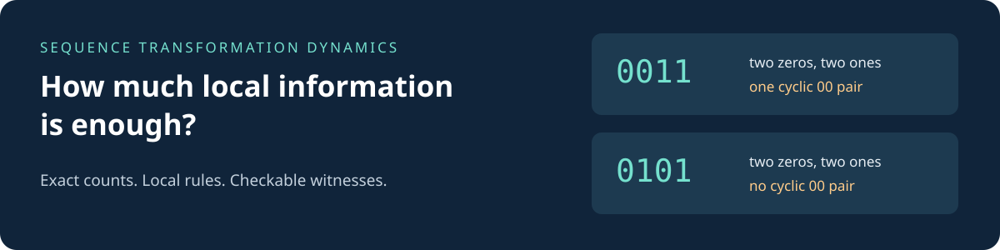

# Sequence Transformation Dynamics

By **Boogieboard113**

**How much local information is enough to predict a transformed sequence?**



Sequence Transformation Dynamics (STD) studies exact prediction of **cyclic block counts** under local rules that emit, replace, or erase symbols. Its *information horizon* is the smallest source-window length whose counts determine the requested output counts throughout a specified source domain.

This repository contains proofs, exact-arithmetic reference code, counterexamples, and reproducible experiments. The accepted core has **internal nonauthor review**. External peer review, proof-assistant verification, and a comprehensive novelty assessment have not been completed.

**[Start here](docs/OVERVIEW.md)** · **[Results and scope](docs/RESULTS.md)** · **[Run the checks](docs/REPRODUCIBILITY.md)** · **[Release status](docs/SNAPSHOT.md)**

## A small example

The cyclic words `0011` and `0101` both contain two zeros and two ones. Their cyclic pair counts differ:

| Source | `00` | `01` | `10` | `11` |
|---|---:|---:|---:|---:|
| `0011` | 1 | 1 | 1 | 1 |
| `0101` | 0 | 2 | 2 | 0 |

For identity output on all nonempty binary cyclic words, symbol counts cannot determine output pair counts; pair counts do. Thus **H(2) = 2**. The [overview](docs/OVERVIEW.md) develops this into a local-emission example where different recurrent components must be compared.

## Try the reviewed core

Extract the ZIP and use Python 3.12 from the `std-public-snapshot` directory. The core and default tests use the standard library.

```bash
python examples/quickstart.py
python -m unittest discover -s tests -v
```

The quickstart checks literal cyclic counts, computes an exact horizon with the reviewed irreducible solver, and executes the reviewed cross-component example. [Reproduction instructions](docs/REPRODUCIBILITY.md) distinguish the core from the optional historical SymPy/C++ experiment.

## What is established

| Result | Essential boundary |
|---|---|
| Exact finite-type horizon criteria using rational rank and support-pair feasibility | Arbitrary positive source lengths; bounded silence for output order greater than one |
| Exact forced-continuation contraction within a histogram fiber | Preserves declared cyclic outputs; does not by itself solve global closure |
| Explicit witness bounds and denominator examples | Witness length, LP denominator, and determinant growth are different quantities |
| Exact fixed-length horizons on disjoint recurrent simple cycles | Vertex-disjoint cycles and nonerasing rules |
| A constant-or-linear alternative for all-finite horizon spectra | Complete local rules on the full cyclic source family |

The [result index](docs/RESULTS.md) links proofs, implementations, and scope limits. Historical directory names and note headers reflect development stages. The result index records the scope selected for this snapshot; [snapshot notes](docs/SNAPSHOT.md) explain the evidence and provenance limits.

## What remains open

General unbounded-erasure decisions, broad fixed-length or fixed-inventory domains, and sharper worst-case denominator/witness bounds remain research questions. The practical JSON analyzer and pending mathematical extensions are outside this snapshot.

The broad historical reset-gap claim was found false under its stated assumptions. The [scoped repair](theorems/errata/reset_gap_scope_and_exact_horizon_2026-10-11.md) does not reinstate it.

## Reading and contributing

- [Overview](docs/OVERVIEW.md): definitions, examples, and method.
- [Related work](docs/RELATED_WORK.md): symbolic dynamics and k-abelian equivalence, with primary references.
- [Contributing](CONTRIBUTING.md): scope, counterexamples, and independent review.
- [Snapshot notes](docs/SNAPSHOT.md): contents, evidence, and limitations.

For citations, credit **Boogieboard113**, name this sanitized research snapshot, and identify the theorem file and its SHA-256 from `SHA256SUMS`. No stable release or DOI is declared. A public-use license has not yet been selected.
